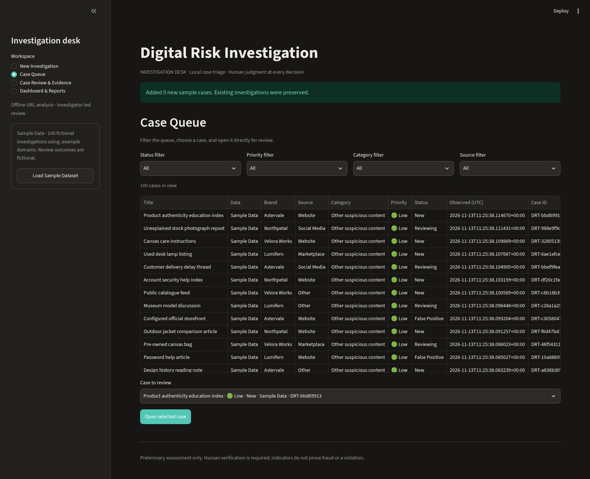
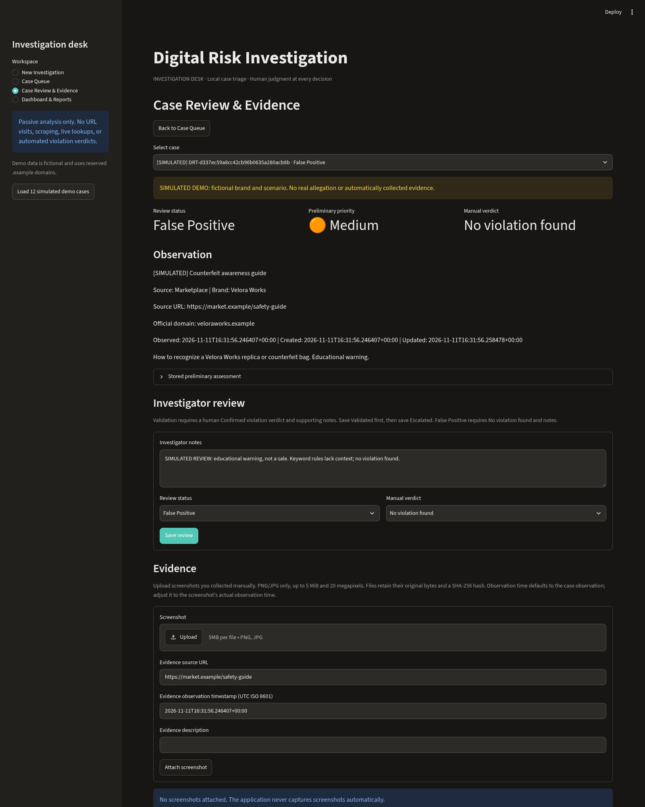

# Digital Risk Triage

A lightweight, local-first investigation desk built with **Python, Streamlit and
SQLite**. Record online observations, prioritize review with explainable rules,
document human decisions, preserve screenshot metadata, and export case reports.
Analysis is preliminary: investigators make the final decisions.

## Features

- Structured intake for websites, social media, marketplaces and other sources.
- Passive URL parsing, domain similarity and explainable category/priority rules.
- A filterable case queue with direct review navigation and readable case titles.
- Investigator notes, manual verdicts, false-positive handling and validation before escalation.
- Manual PNG/JPEG evidence uploads with source/time metadata and SHA-256 hashes.
- Dashboard metrics, a category chart and filtered CSV/Excel exports.
- **100 varied sample investigations**, including the original 12 scenarios.
- Native dark Streamlit theme; no API keys or external services required.

## Screenshots

Captured from the running application in Chromium using isolated sample data:





Also view [new investigation intake](docs/screenshots/new-investigation.png) and
[dashboard and reports](docs/screenshots/dashboard-reports.png).

## Run locally on Windows and in Visual Studio Code

Install **Python 3.11 or newer**. Open the repository folder in VS Code, choose
**Terminal → New Terminal**, and run these commands from that folder:

```powershell
py -3 --version
py -3 -m venv .venv
.\.venv\Scripts\python.exe -m pip install -r requirements.txt
.\.venv\Scripts\python.exe -m streamlit run app.py --server.address 127.0.0.1
```

In VS Code, use **Python: Select Interpreter** from the Command Palette and select
`.venv\Scripts\python.exe`. Open the local address printed by Streamlit. Stop with
`Ctrl+C`; subsequent launches need only the final command. Append
`--server.port 8502` if port 8501 is occupied. Using the environment's Python
directly avoids PowerShell activation-policy changes.

Run tests:

```powershell
.\.venv\Scripts\python.exe -m pytest -q
```

### Linux / macOS

```bash
python3 -m venv .venv
.venv/bin/python -m pip install -r requirements.txt
.venv/bin/python -m streamlit run app.py --server.address 127.0.0.1
# In another terminal, or after stopping Streamlit:
.venv/bin/python -m pytest -q
```

Installation requires package downloads. The investigation workflow then runs
offline: submitted URLs are inspected as strings and are never visited.
Streamlit usage telemetry is disabled.

## Investigation workflow

1. **New Investigation:** supply a URL or meaningful title/description. Brand and
   official domain are optional; supplying both enables domain comparison. Analyze
   the observation, inspect the preliminary indicators, then save it. After editing
   a form, analyze again before saving; the preview identifies the saved submission.
2. **Case Queue:** filter by status, priority, category or source. Select a case and
   choose **Open selected case**. Returning to the queue preserves its filters.
   Sample records carry a small **Sample Data** label; manual records show
   **Investigator intake**.
3. **Case Review & Evidence:** inspect the stored analysis, add notes, and record
   a manual verdict. **Validated** requires **Confirmed violation** and supporting
   notes. Save that state before **Escalated**. **False Positive** requires
   **No violation found** and notes. Reopening a case clears validation, so it must
   be validated again before escalation. Review decisions do not rewrite the
   original preliminary assessment.
4. **Evidence:** manually upload a PNG/JPEG screenshot. Check the source URL and
   timezone-aware observation time; the default is the case observation time.
   The app stores original bytes, upload time, filename, size and SHA-256 hash.
5. **Dashboard & Reports:** see totals, awaiting review (New + Reviewing), validated
   cases (Validated + Escalated), false positives and category distribution.
   Independent report filters control CSV and Excel downloads.

## Load the 100-case sample dataset

Choose **Load Sample Dataset** in the sidebar. A fresh database receives exactly
100 sample records. An installation with the original 12 receives only the 88
missing scenarios. Repeated loading inserts zero records. The confirmation reports
how many records were added.

Stable `demo_key` values and the existing `is_demo` marker preserve identity.
Existing records are skipped, including their notes, verdicts, titles, timestamps
and evidence. Legacy `[SIMULATED]` title prefixes are hidden only in the UI; stored
records and exported intake text remain intact. Manual investigations are retained.

Sample content lives in **`datasets/sample_cases.json`**, separate from application
logic so scenarios and fictional review metadata can be inspected without editing
Python. The versioned JSON contains the same 100 records, with their original keys,
inputs, notes, statuses and intended manual verdicts.

**`core/dataset_loader.py`** resolves the file relative to the project directory,
independently of the terminal's working directory. Before inserting anything, it
validates the entire file: structure/version, required string fields, unique keys,
supported fictional brand/domain pairs, reserved `.example` URLs, sample
status/verdict pairs and supporting review notes. Existing `Intake` and URL
validation are reused. Missing files and invalid records produce readable errors
without resetting SQLite or silently skipping bad records.

The loader sends missing records through `Database.create_case()`, which runs the
existing rule engine. Category and priority are not JSON inputs. Fictional review
outcomes use `Database.update_review()`, including validation before escalation.
Existing sample keys are skipped, so manual and sample investigations coexist in
the same SQLite database without overwriting notes, verdicts, evidence or timestamps.
`core/demo.py` retains `load_demo()` as a small compatibility wrapper; Python fixture
lists have been removed. The JSON is tracked in Git; runtime `data/` remains ignored.

All scenarios use four fictional brands—Astervale, Lumifern, Velora Works and
Northpetal—and reserved `.example` domains. Sample review notes and completed
verdicts describe **fictional investigation outcomes**. No screenshots are seeded
and no evidence is claimed to have been collected automatically.

On a fresh load, the **unchanged rule engine** produces:

| Preliminary category | Cases |
| --- | ---: |
| Potential phishing | 25 |
| Potential brand impersonation | 25 |
| Potential counterfeit listing | 20 |
| Potential trademark misuse | 15 |
| Other suspicious content | 15 |
| **Total** | **100** |

Priorities: **16 High, 69 Medium, 15 Low**. Review statuses: **41 New, 25 Reviewing,
12 Validated, 13 False Positive, 9 Escalated**. Manual verdicts: **41 Pending review,
25 Inconclusive, 21 Confirmed violation, 13 No violation found**. These are fixture
outcomes, not classifier accuracy measurements. Counts may differ after loading
into an existing database because investigator edits are preserved.

The dataset includes credential and OTP requests, payment pressure, lookalike
addresses, support profiles, reseller claims, imitation listings and logo-use
contexts. Benign examples include educational material, authorized pages, normal
resale and URLs with security-related keywords. Some benign records deliberately
trigger rules so the review workflow demonstrates false-positive handling.

## How assessment works

`core/url_analysis.py` normalizes HTTP(S) URLs and inspects hostname structure,
punycode, IP hosts, nested subdomains, userinfo, embedded URLs and unusual length.
`tldextract` uses its bundled suffix list without downloading or caching it.
Unknown suffixes such as `.example` use a best-effort last-two-label fallback.

With a brand and configured official domain, RapidFuzz compares registered-name
labels, excluding shared suffixes. An outside name with at least four characters
and 80/100 similarity, or official-domain text placed inside an unrelated hostname,
can flag resemblance. Host matching respects subdomain boundaries. Similarity is
not a probability or proof of ownership.

`core/risk_rules.py` checks the title and description for credential requests,
verification/suspension wording, urgency, affiliation, replica terms and trademark
use. Brand-specific text checks require the named brand to occur in the content;
investigator notes are excluded. Category precedence is phishing, marketplace
counterfeit, outside-host affiliation, trademark use, domain resemblance, then
other content. High priority requires credential requests plus verification or
urgency on a host outside the configured official domain. Other configured risk
signals receive Medium; remaining observations receive Low. No fixture forces a
category or priority.

## Evidence, reports and local storage

Screenshots are limited to **5 MiB, 20 megapixels and one still frame**. Pillow
checks PNG/JPEG content, extension agreement and decoding. Evidence filenames use
UUIDs; metadata references an existing case. Failed metadata writes clean up the
new file. A hash supports integrity comparison, not authenticity verification.

CSV includes notes, verdict/status, assessment details, timestamps and evidence
IDs/paths/hashes/source times. Excel adds a detailed **Evidence** sheet. Reports
contain references, not embedded images. Both formats retain an explicit
`data_label`: **SIMULATED DEMO** for samples and **Investigator intake** otherwise.
Sample review notes also identify fictional outcomes. Formula prefixes are
neutralized with an apostrophe; unsupported XML controls are removed. Excel cells
over 32,767 characters are rejected with guidance to export CSV instead.

The database defaults to `data/cases.sqlite3`, with screenshots in `data/evidence/`.
Set the optional `DRT_DATA_DIR` environment variable to use a separate local data
directory. Stop the application and back up the database and evidence directory
together. Local data is Git-ignored. Tests use `data/test-tmp/`; do not store user
investigations there.

## Architecture

```text
app.py                       Native Streamlit interface and navigation
core/models.py               Intake validation, enums and UTC timestamps
core/url_analysis.py         Offline URL/domain inspection
core/risk_rules.py           Explainable preliminary category and priority
core/database.py             SQLite persistence and review transition validation
core/evidence.py             Image validation, storage and SHA-256 metadata
core/reporting.py            Formula-safe CSV and Excel reports
core/dataset_loader.py       JSON validation and idempotent sample seeding
core/demo.py                 Backward-compatible load_demo() wrapper
datasets/sample_cases.json   All 100 unchanged sample inputs and fictional reviews
tests/                       Core, dataset migration, export and UI workflow tests
.streamlit/config.toml       Dark theme, upload cap and telemetry settings
```

## Validation

Executed on Linux with Python 3.12:

- Pre-refactor baseline: **73 tests passed**.
- Updated `python -m pytest -q`: **116 passed**, covering fresh/repeated loading,
  upgrade from the original 12, record/evidence preservation, review transitions,
  JSON structure/field errors, duplicate keys, missing/malformed files, working
  directory independence, reserved domains, actual rule outputs, export provenance
  and UI presentation. Invalid records are rejected before any case is inserted.
  Existing URL, evidence hashing/validation and spreadsheet formula tests also pass.
- Compared all 100 JSON records and imported case contents against the original
  Python fixtures: inputs, stable keys, notes, statuses, verdicts and computed
  assessments match exactly. A regression checksum protects the extracted content.
- `python -m pip check`: no broken requirements.
- Streamlit startup and local HTTP health check succeeded using isolated data.
- Chromium exercised sample loading twice, queue filters, direct review navigation,
  return navigation with retained filters, sample labels, dashboard metrics/chart,
  and CSV/Excel downloads. No page errors or external HTTP requests occurred.
  Existing screenshots above remain representative; the UI was not redesigned.

A native Windows run and GitHub-hosted CI were not executed in this environment.
Evidence uploads were covered by automated tests; this pass did not repeat manual
browser evidence upload or server-restart checks.

## Limitations

- Text rules do not understand intent, negation, quotations or permission. They can
  miss unfamiliar wording or flag benign content; independent human review remains
  necessary. A lack of indicators does not establish safety.
- Domain comparison is character-based and provides no live DNS, WHOIS, ownership
  or reputation verification. Evidence collection is manual.
- Designed for one local investigator: no authentication, encryption at rest,
  immutable audit history, automatic backup or multi-user conflict handling.
  Keep the server on loopback and protect stored data and reports.
- Intake content is a stored snapshot; only review fields are editable through the
  UI. Arbitrary historical schema migrations and very large collections are beyond
  the current MVP. Sample loading preserves existing records rather than resetting
  them to the fixture state.
