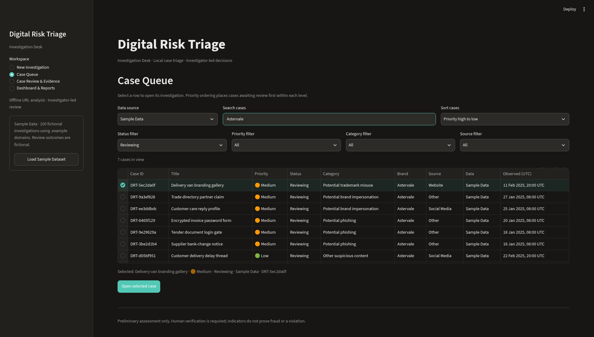
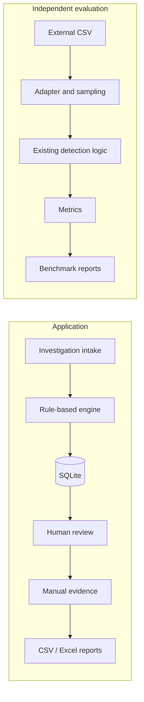

# Digital Risk Triage

A lightweight, local-first investigation desk built with **Python, Streamlit and
SQLite**. Record online observations, prioritize review with explainable rules,
document human decisions, preserve screenshot metadata, and export case reports.
Analysis is preliminary: investigators make the final decisions.

## Features

- Structured intake for websites, social media, marketplaces and other sources.
- Passive URL parsing, domain similarity and explainable category/priority rules.
- A searchable case queue with sample/intake filters, deterministic sorting and native row selection.
- Optional observation-time entry with UTC preview and readable case identifiers.
- Investigator notes, manual verdicts, false-positive handling and validation before escalation.
- Manual PNG/JPEG evidence uploads with source/time metadata and SHA-256 hashes.
- Dashboard metrics, a category chart and filtered CSV/Excel exports.
- **100 varied sample investigations**, including the original 12 scenarios.
- Native dark Streamlit theme; no API keys or external services required.

## Screenshots

Actual Phase 2 captures from Chromium, using a consistent 1920-pixel-wide viewport
and isolated fictional records. These images remain unchanged in Phase 3.



View [Case Review & Evidence](docs/screenshots/case-review.png),
[New Investigation with UTC preview](docs/screenshots/new-investigation.png), and
[Dashboard & Reports scoped to Sample Data](docs/screenshots/dashboard-reports.png).

## Investigation workflow

1. **New Investigation:** supply a URL or meaningful title/description. Brand and
   official domain are optional; supplying both enables domain comparison. Leave
   **Observation time (optional, UTC)** blank for automatic UTC, or enter an ISO
   timestamp with `Z` or an explicit offset, such as `2025-01-06T15:00:00+07:00`.
   Analyze the observation, inspect the UTC time and preliminary indicators, then
   save it. Save submits current form values too: edited inputs require a fresh
   analysis, and invalid or future times are rejected.
2. **Case Queue:** choose **All cases**, **Sample Data** or **Investigator intake**,
   together with status, priority, category and source-type filters. Search by
   title, full Case ID, brand or source URL, ignoring letter case. The default
   **Priority high to low** puts New/Reviewing cases first within each priority,
   followed by newest observation time and full Case ID to break ties. **Priority
   low to high**, **Newest observed** and **Oldest observed** are also available.
   Select a table row and choose **Open selected case**. Returning to the queue
   preserves filters, search, sorting and the selected case when still visible.
   Short IDs are for display; navigation always uses the complete Case ID.
   Sample records carry **Sample Data** labels; manual records show **Investigator intake**.
3. **Case Review & Evidence:** review the summary and observation details, inspect
   the preliminary assessment, then add investigator notes and a separate manual
   verdict. **Case metadata** exposes the full Case ID and timestamps; assessment
   reasoning and raw URL details remain available in expanders.
   **Validated** requires **Confirmed violation** and supporting
   notes. Save that state before **Escalated**. **False Positive** requires
   **No violation found** and notes. Reopening a case clears validation, so it must
   be validated again before escalation. Review decisions do not rewrite the
   original preliminary assessment. New requires Pending review. Reviewing supports
   Pending review, Inconclusive, or a provisional No violation found with supporting
   notes. False Positive closes a cleared reported concern; a positive machine
   detection is not required.
4. **Supporting evidence:** expand **Attach a screenshot** to manually upload a
   PNG/JPEG image. Check the source URL and timezone-aware observation time; the
   default is the case observation time. The app stores original bytes, upload
   time, filename, size and SHA-256 hash. Preview cards retain detailed metadata
   in expanders.
5. **Dashboard & Reports:** see totals, awaiting review (New + Reviewing), validated
   cases (Validated + Escalated), false positives and category distribution.
   **Data source** scopes both metrics and the chart; the active scope and sample/
   intake counts are shown explicitly. The four report filters further narrow
   that scope for CSV and Excel downloads. An empty scope shows zero metrics and
   disables report downloads.

### Observation and storage times

`observed_at` records when the reported observation occurred; `created_at` records
when the case was added locally, and `updated_at` records its latest stored update.
`Database.create_case(intake, observed_at="2025-01-06T15:00:00+07:00")` accepts an
optional timezone-aware ISO 8601 observation time, normalizes it to UTC and rejects
invalid/future values. Omitting it preserves the current UTC default. The intake
form uses this same validation and API, retaining the analyzed timestamp through
Preview → Save. Ordinary tables and summaries show times such as
`06 Jan 2025, 08:00 UTC`, without microseconds. **Case metadata** and the canonical
**Download CSV** / **Download Excel** reports retain full IDs and original timestamp
precision; compact queue displays do not rewrite stored values.
Reviews leave observation/creation times intact. Existing SQLite columns are reused
without a migration, reset or automatic timestamp correction.

## Architecture

The application and offline evaluation use the same existing detection logic;
evaluation has no connection to the investigator database or evidence directory.



| Component | Responsibility |
|---|---|
| `app.py`, `core/presentation.py` | Native Streamlit workflows, display, source filters and queue ordering |
| `core/models.py` | Intake validation, review choices and UTC timestamps |
| `core/url_analysis.py`, `core/risk_rules.py` | Offline URL inspection and explainable preliminary assessment |
| `core/database.py`, `core/dataset_loader.py` | SQLite, review validation and atomic/idempotent JSON import |
| `core/evidence.py`, `core/reporting.py` | Image validation, original bytes, SHA-256 metadata and spreadsheet-safe reports |
| `datasets/sample_cases.json` | 100 fictional observations and review outcomes; never benchmark ground truth |
| `evaluation/` | Local CSV adapter, separate protocols, binary metrics and hash-only reports |
| `tests/`, `.github/workflows/tests.yml` | Regression tests and CI lint/test checks |

## Load the 100-case sample dataset

Choose **Load Sample Dataset** in the sidebar. A fresh database receives exactly
100 sample records. An installation with the original 12 receives only the 88
missing scenarios. Repeated loading inserts zero records. The confirmation reports
how many records were added.

Stable `demo_key` values and the existing `is_demo` marker preserve identity.
Existing records are skipped, including their notes, verdicts, titles, timestamps
and evidence. Legacy `[SIMULATED]` title prefixes are hidden only in the UI; stored
records and exported intake text remain intact. Manual investigations are retained.

Sample content lives in **`datasets/sample_cases.json`**, separate from application
logic so scenarios and fictional review metadata can be inspected without editing
Python. The versioned JSON contains the same 100 keys, observation text, statuses
and intended manual verdicts. The [Phase 1 audit](docs/phase-1-audit.md) documents
nine clarified fictional review rationales and fixed observation-time metadata.

**`core/dataset_loader.py`** resolves the file relative to the project directory,
independently of the terminal's working directory. Before inserting anything, it
validates the entire file: structure/version, required string fields, unique keys,
supported fictional brand/domain pairs, reserved `.example` URLs, sample
status/verdict pairs, supporting review notes and optional `observed_at` timestamps.
Existing `Intake`, URL and timestamp validation are reused. Missing files and invalid
records produce readable errors without resetting SQLite or silently skipping bad records.

The loader sends missing records through `Database.create_case()`, which runs the
existing rule engine. Category and priority are not JSON inputs. Fictional review
outcomes use `Database.update_review()`, including validation before escalation.
All missing inserts and seeded reviews share one transaction; a runtime failure
rolls back that import. Stable keys are checked under the same write lock.
Existing sample keys are skipped, so manual and sample investigations coexist in
the same SQLite database without overwriting notes, verdicts, evidence or timestamps.
`core/demo.py` retains `load_demo()` as a small compatibility wrapper; Python fixture
lists have been removed. The JSON is tracked in Git; runtime `data/` remains ignored.

All scenarios use four fictional brands—Astervale, Lumifern, Velora Works and
Northpetal—and reserved `.example` domains. Sample review notes and completed
verdicts describe **fictional investigation outcomes**. No screenshots are seeded
and no evidence is claimed to have been collected automatically.

All 100 bundled `observed_at` values are fictional fixture metadata, fixed at
12-hour intervals from **2025-01-06 08:00 UTC to 2025-02-24 20:00 UTC**. They describe
an exercise period, not live observations or an invented review history. Creation,
update and validation times record local storage operations. Older JSON without
observation timestamps remains supported. Already loaded cases keep their original
notes and all timestamps; fixture corrections are not backfilled into user data.

On a fresh load, the **unchanged rule engine** produces:

| Preliminary category | Cases |
| --- | ---: |
| Potential phishing | 25 |
| Potential brand impersonation | 25 |
| Potential counterfeit listing | 20 |
| Potential trademark misuse | 15 |
| Other suspicious content | 15 |
| **Total** | **100** |

Priorities: **16 High, 69 Medium, 15 Low**. Review statuses: **41 New, 25 Reviewing,
12 Validated, 13 False Positive, 9 Escalated**. Manual verdicts: **41 Pending review,
25 Inconclusive, 21 Confirmed violation, 13 No violation found**. These are fixture
outcomes, not classifier accuracy measurements. Counts may differ after loading
into an existing database because investigator edits are preserved.

The dataset includes credential and OTP requests, payment pressure, lookalike
addresses, support profiles, reseller claims, imitation listings and logo-use
contexts. Benign examples include educational material, authorized pages, normal
resale and URLs with security-related keywords. Some benign records deliberately
trigger rules so the review workflow demonstrates false-positive handling.

## How assessment works

`core/url_analysis.py` normalizes HTTP(S) URLs and inspects hostname structure,
punycode, IP hosts, nested subdomains, userinfo, embedded URLs and unusual length.
`tldextract` uses its bundled suffix list without downloading or caching it.
Unknown suffixes such as `.example` use a best-effort last-two-label fallback.

With a brand and configured official domain, RapidFuzz compares registered-name
labels, excluding shared suffixes. An outside name with at least four characters
and 80/100 similarity, or official-domain text placed inside an unrelated hostname,
can flag resemblance. Host matching respects subdomain boundaries. Similarity is
not a probability or proof of ownership.

`core/risk_rules.py` checks title/description for credentials, verification, urgency,
affiliation, replica terms and trademark use. Brand text checks require the named
brand in the content; investigator notes are excluded. Category precedence is
phishing, marketplace counterfeit, outside-host affiliation, trademark use, domain
resemblance, then other content. High priority requires credentials plus verification
or urgency without a configured official-host match. Other configured priority
conditions yield Medium; structural warnings such as an IP host alone leave Low.
No fixture forces a category or priority.

`Other suspicious content` is the compatibility fallback when no more specific
category matches, including observations without configured risk indicators.
Categories and Low/Medium/High priorities guide review; human verdicts record
separate decisions. Low does not establish legitimacy, and High does not establish
a confirmed violation.

## Evidence, reports and local storage

Screenshots are limited to **5 MiB, 20 megapixels and one still frame**. Pillow
checks PNG/JPEG content, extension agreement and decoding. Evidence filenames use
UUIDs; metadata references an existing case. Failed metadata writes clean up the
new file. A hash supports integrity comparison, not authenticity verification.

CSV includes notes, verdict/status, assessment details, timestamps and evidence
IDs/paths/hashes/source times. Excel adds a detailed **Evidence** sheet. Reports
contain references, not embedded images. Both formats retain an explicit
`data_label`: **SIMULATED DEMO** for samples and **Investigator intake** otherwise.
Sample review notes also identify fictional outcomes. Formula prefixes are
neutralized with an apostrophe; unsupported XML controls are removed. Excel cells
over 32,767 characters are rejected with guidance to export CSV instead.

The database defaults to `data/cases.sqlite3`, with screenshots in `data/evidence/`.
Set the optional `DRT_DATA_DIR` environment variable to use a separate local data
directory. Stop the application and back up the database and evidence directory
together. Local data is Git-ignored. Tests use `data/test-tmp/`; do not store user
investigations there.

## Evaluation methodology and status

The [offline evaluation module](evaluation/README.md) compares URL-only behavior
with the official [PhiUSIIL dataset](https://archive.ics.uci.edu/dataset/967/phiusiil+phishing+url+dataset).
It runs independently of Streamlit, SQLite and the synthetic cases.

| Protocol | What it measures | Interpretation |
|---|---|---|
| `assessment` | Existing `assess()` with URL only; empty brand/title/description | Limited-input diagnostic: the current rules always predict negative, matching the always-legitimate baseline |
| `url-screening` | One or more existing structural URL indicators | Review flags compared with phishing labels; not confirmed phishing or review priority |

Phishing classification depends on credential/verification/urgency text that this
URL-only benchmark does not supply. Rules were not changed to improve scores.
Brand/domain similarity also needs context that neither protocol receives.

**The full PhiUSIIL benchmark ran successfully on Windows on 15 November 2026**
using the original locally supplied CSV and clean source commit
[`53e8310`](https://github.com/strltP/digital-risk-triage/commit/53e831049800c7563a722482c645ff77f9744e07).
Of **235,795** original records, preprocessing excluded **4** invalid URLs,
**897** duplicate rows and **2** conflicting-label rows, leaving **234,892**
unique usable records: **100,043 phishing** and **134,849 legitimate**.
This run used the entire cleaned dataset, retaining its class distribution;
it was not a balanced sample.

| Protocol | TP | FP | TN | FN | Precision | Recall | F1 | FPR |
|---|---:|---:|---:|---:|---:|---:|---:|---:|
| A: `assessment` | 0 | 0 | 134,849 | 100,043 | Undefined* | 0.00% | 0.00% | 0.00% |
| B: `url-screening` | 6,496 | 227 | 134,622 | 93,547 | 96.62% | 6.49% | 12.17% | 0.17% |

*Protocol A makes no positive predictions. Precision is undefined and represented
as `0.0` with an explicit `undefined_metrics` entry in the JSON.

URL screening has high precision **on this dataset**, but very low recall:
**93,547 of 100,043 phishing URLs (93.51%) remain unflagged**. Its structural flags
identify only a small subset of labeled phishing URLs; absence of a flag does not
establish safety. Protocol A lacks the text inputs required by the existing phishing
rules and matches the always-legitimate baseline. These results are not the overall
accuracy of the investigation application.

See the committed [full report](docs/benchmarks/phiusiil-full-2026-11-15.md),
[authoritative JSON](docs/benchmarks/phiusiil-full-2026-11-15.json) and
[confusion matrices](docs/benchmarks/phiusiil-full-2026-11-15.md#confusion-matrices).
The dataset is attributed to **Arvind Prasad and Shalini Chandra (2024), UCI Machine
Learning Repository**, under **CC BY 4.0**; official labels are `0 = phishing`,
`1 = legitimate`. The CSV SHA-256 recorded in the benchmark metadata is:

```text
a236549cd369cd80bd478ff8e1779cbf44c58d5c3f79f7a51a1adbed7d06d1c6
```

The report records Python **3.11.9**, RapidFuzz **3.14.6**, tldextract **5.4.0** and
a clean working tree. Its provenance note remains explicit: the CSV was locally
supplied and its origin was not independently authenticated by the evaluator.
The Cloud download failure on 14 November is historical; it does not describe the
later Windows run. See the [acquisition history](docs/phase-3-review.md).

To reproduce the full run with the same CSV and source commit:

```bash
python -m evaluation.evaluate --dataset evaluation/data/PhiUSIIL_Phishing_URL_Dataset.csv --full --seed 42 --protocol both --output evaluation/results/phiusiil-full
```

Full mode ignores the seed and retains every cleaned record. Reports include
input/selection fingerprints, code/environment provenance, exclusions, separate
metrics, baselines, confusion matrices and hash-only error examples. The raw CSV
and full phishing URLs are not committed. See [evaluation instructions](evaluation/README.md)
for schema, balanced sampling and reproducibility details.

The optional balanced sampling mode changes prevalence; the published full run
retains the cleaned class distribution. Dataset precision may still differ from
operational traffic. Accuracy alone can conceal zero recall. Undefined ratios are explicitly
listed and represented as zero, rather than claimed as measured precision. A URL
indicator is not a fraud probability; High priority does not establish wrongdoing.
This experiment does not measure counterfeit/trademark accuracy, platform-wide
impersonation detection, investigator decisions, evidence authenticity or overall
application accuracy.

## Testing and reliability

Locally executed on Linux / Python 3.12:

- Phase 2 baseline independently confirmed: **253 passed**.
- Phase 3 full suite: **267 passed, 0 failed, 0 skipped**. Fourteen additional
  evaluation cases cover the negative-only diagnostic and safe report destinations.
  Existing loading/upgrade, atomic rollback, stable keys, SQLite persistence, review,
  timestamps, queue navigation/search/filters, dashboard, evidence and export tests
  remain intact. Evaluation tests use synthetic reserved-domain fixtures, with
  network/database isolation checks.
- **Ruff 0.11.13:** `python -m ruff check .` passes. Minimal rules **E4, E7, E9, F**
  check syntax/import/name errors without a formatting sweep. Ruff is in
  `requirements-dev.txt`; production requirements are unchanged.
- `python -m pip check`: no broken requirements.
- GitHub Actions installs pinned development requirements and runs Ruff followed by
  Pytest with read-only repository permissions. No external dataset is required.
  Local equivalents passed; consult the branch's Actions run for hosted status.

Phase 2's actual Chromium smoke tests covered native row selection, retained
navigation, timestamp saving/rejection, review rules, PNG upload/preview, scoped
CSV/Excel downloads and server restart. Bytes/hashes and 102 pre-existing test
records were preserved. Phase 3 leaves the application, core rules, sample JSON,
theme and those screenshots unchanged; it does not claim a repeated browser suite.
The offline full benchmark was subsequently executed on Windows / Python 3.11.9;
Windows application UI execution remains unverified.

## Run locally on Windows and in Visual Studio Code

Install **Python 3.11 or newer**. Open the repository folder in VS Code, choose
**Terminal → New Terminal**, and run these commands from that folder:

```powershell
py -3 --version
py -3 -m venv .venv
.\.venv\Scripts\python.exe -m pip install -r requirements.txt
.\.venv\Scripts\python.exe -m streamlit run app.py --server.address 127.0.0.1
```

In VS Code, use **Python: Select Interpreter** from the Command Palette and select
`.venv\Scripts\python.exe`. Open the local address printed by Streamlit. Stop with
`Ctrl+C`; subsequent launches need only the final command. Append
`--server.port 8502` if port 8501 is occupied. Using the environment's Python
directly avoids PowerShell activation-policy changes.

For development checks, install the pinned lint dependency separately:

```powershell
.\.venv\Scripts\python.exe -m pip install -r requirements-dev.txt
.\.venv\Scripts\python.exe -m ruff check .
.\.venv\Scripts\python.exe -m pytest -q
```

### Linux / macOS

```bash
python3 -m venv .venv
.venv/bin/python -m pip install -r requirements.txt
.venv/bin/python -m streamlit run app.py --server.address 127.0.0.1
# In another terminal, or after stopping Streamlit:
.venv/bin/python -m pip install -r requirements-dev.txt
.venv/bin/python -m ruff check .
.venv/bin/python -m pytest -q
```

Installation requires package downloads. The investigation workflow then runs
offline: submitted URLs are inspected as strings and are never visited.
Streamlit usage telemetry is disabled.

## Limitations

- Text rules do not understand intent, negation, quotations or permission. They can
  miss unfamiliar wording or flag benign content; independent human review remains
  necessary. A lack of indicators does not establish safety.
- Domain comparison is character-based and provides no live DNS, WHOIS, ownership
  or reputation verification. Evidence collection is manual.
- Designed for one local investigator: no authentication, encryption at rest,
  immutable audit history, automatic backup or multi-user conflict handling.
  Keep the server on loopback and protect stored data and reports.
- Intake content is a stored snapshot; only review fields are editable through the
  UI. Arbitrary historical schema migrations and very large collections are beyond
  the current MVP. Sample loading preserves existing records rather than resetting
  them to the fixture state.

## Licensing and repository metadata

No `LICENSE` file is present. The owner must choose a license before offering
open-source reuse; MIT is a simple portfolio option, subject to that decision.
No license was added during this review. PhiUSIIL's **CC BY 4.0** dataset attribution
is separate from the application's licensing.

The GitHub description and topics are currently empty. Metadata write access was
unavailable through the supplied tools; recommended values and the verified status
are recorded in the [Phase 3 review](docs/phase-3-review.md#repository-metadata-and-licensing).
